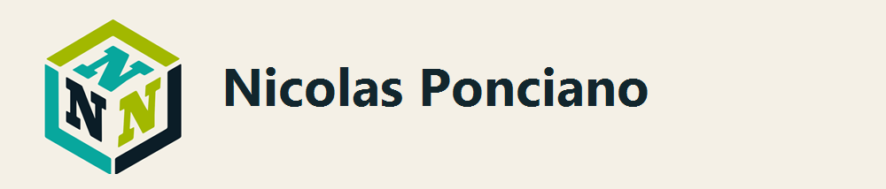
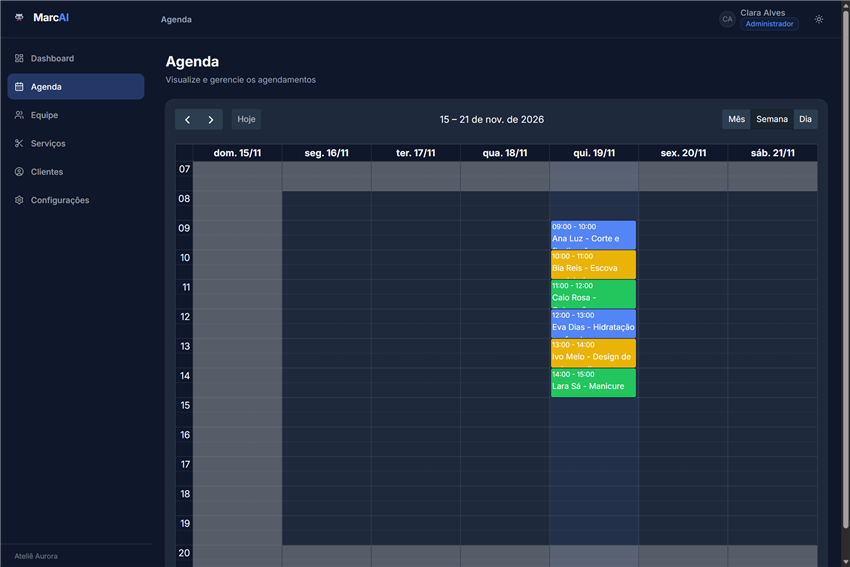

<picture>
  <source media="(prefers-color-scheme: dark)" srcset="assets/capa-dark.png">
  
</picture>

Desenvolvo e mantenho sistemas web corporativos com .NET e SQL Server. Na ClienteAPI, integrei o cadastro de clientes ao ViaCEP para consultar endereços e buscar clientes pelo CEP.

**[Ver a API de clientes em C#](https://github.com/nicolasponciano/ClienteAPI)** · [Meu portfólio](https://nicolasponciano.github.io/) · [LinkedIn](https://www.linkedin.com/in/nicolas-ponciano/)

## MarcAi

Criei uma agenda para salões, clínicas e estúdios. Os horários disponíveis dependem do profissional e da duração do serviço. Antes de confirmar a reserva, verifico no servidor se outra pessoa já marcou aquele horário.

[Experimentar o agendamento](https://marcai-demo.netlify.app/) · [Como construí o MarcAi com Next.js, TypeScript e PostgreSQL](https://nicolasponciano.github.io/#projeto/marcai)

## Seirei

Fiz o Seirei para acompanhar uma tarefa por vez, no computador ou no celular. A IA sugere por onde começar. Se a chamada falhar, o aplicativo segue a ordem em que as tarefas foram adicionadas.

[Ver o Seirei no portfólio](https://nicolasponciano.github.io/#projeto/seirei) · Next.js, TypeScript e Supabase

## Open Mind

Escrevi um plugin em TypeScript para consultar minhas notas do Obsidian dentro do OpenCode. Limitei a busca à pasta do vault e deixei a escrita desabilitada por padrão.

[Ler o código do Open Mind](https://github.com/nicolasponciano/open-mind)
