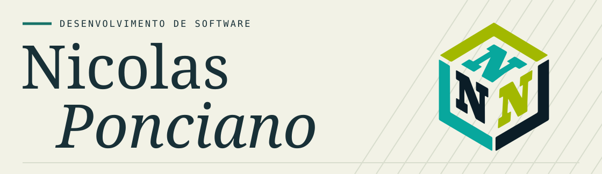
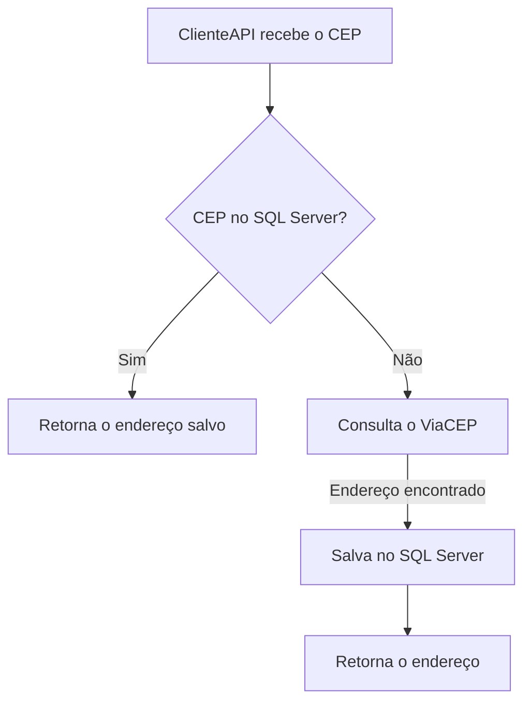

<picture>
  <source media="(prefers-color-scheme: dark)" srcset="./assets/editorial-dark.svg">
  
</picture>

Desenvolvo aplicações web, integro APIs e mantenho sistemas em produção. Também crio ferramentas para o meu dia a dia. Uma delas me deixa consultar minhas notas do Obsidian enquanto programo.

[Projetos](#projetos)　·　[Tecnologias](#tecnologias)　·　[Contato](#contato)

## Projetos

### MarcAI

Cada profissional tem sua agenda. O cliente escolhe um horário pela página pública e faz o agendamento. [Abrir a demo](https://marcai-demo.netlify.app/)

<details>
<summary>Ver a agenda por dentro</summary>


Desenvolvi a aplicação com Next.js, TypeScript e PostgreSQL. Os papéis de acesso separam o que cada pessoa pode ver e fazer na agenda.

</details>

### Open Mind

Criei um plugin para consultar minhas notas de projeto no Obsidian sem sair do OpenCode. [Ver o código](https://github.com/nicolasponciano/open-mind)

<details>
<summary>Como buscar uma decisão nas notas</summary>

Para procurar referências a agendamento nas notas de projetos, a ferramenta `open_mind_search` recebe estes argumentos:

```json
{
  "query": "agendamento",
  "scope": "projetos"
}
```

O resultado traz o trecho encontrado e o caminho da nota dentro do vault.

</details>

### ClienteAPI

Uma API em C# para cadastrar clientes e preencher o endereço a partir do CEP. [Ver o código](https://github.com/nicolasponciano/ClienteAPI)

<details>
<summary>Como funciona a consulta por CEP</summary>

A API procura o CEP no SQL Server. Quando encontra, devolve o endereço salvo. Na primeira consulta a um CEP válido, busca os dados no ViaCEP e guarda o resultado.



</details>

## Tecnologias

| Onde uso | Tecnologias |
| --- | --- |
| Aplicações web |   |
| APIs |   |
| Manutenção |   |
| Dados |    |

## Contato

[Portfólio](https://nicolasponciano.github.io/) · [LinkedIn](https://www.linkedin.com/in/nicolas-ponciano/) · [E-mail](mailto:niickponciano@gmail.com)
