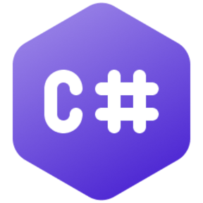

<picture>
  <source media="(prefers-color-scheme: dark)" srcset="assets/logo-dark.svg">
  
</picture>

# Nicolas Ponciano

Desenvolvo sistemas web corporativos com .NET e SQL Server. Nos meus projetos, também uso TypeScript para criar aplicativos e ferramentas que uso no dia a dia.

```ts
const meuPerfil = {
  atuacao: "Desenvolvimento full stack",
  trabalhoCom: ["APIs", "Integrações", "Bancos relacionais"],
  estouEstudando: "Pós-graduação em Inteligência Artificial",
};
```

[Meu portfólio](https://nicolasponciano.github.io/) · [LinkedIn](https://www.linkedin.com/in/nicolas-ponciano/)

## Tecnologias que uso

<code></code> <code></code> <code></code> <code></code>

## Meus projetos

- **MarcAi** — Criei uma agenda para salões, clínicas e estúdios. A página pública de cada estabelecimento mostra os horários disponíveis por profissional e serviço. [Experimentar o agendamento](https://marcai-demo.netlify.app/)

  <details>
  <summary>Como evito duas reservas no mesmo horário?</summary>

  `Next.js` `TypeScript` `PostgreSQL`

  Calculo a disponibilidade a partir da agenda e da duração do serviço. Antes de confirmar, verifico o conflito no servidor. Se o mesmo pedido chegar duas vezes, reconheço a repetição pela chave de idempotência.

  [](https://nicolasponciano.github.io/assets/projects/marcai/02-agenda.png)

  </details>

- **Seirei** — Fiz um aplicativo para trabalhar em uma tarefa por vez e continuar de onde parei ao trocar o computador pelo celular. [Ver o modo foco](https://nicolasponciano.github.io/#projeto/seirei)

  <details>
  <summary>E se a IA não conseguir ordenar as tarefas?</summary>

  `Next.js` `TypeScript` `Supabase`

  Guardo a ordem de inserção no Supabase. Confiro a sequência sugerida pela IA contra as tarefas do dia e, se a chamada falhar, uso a ordem original.

  

  </details>

- **Open Mind** — Escrevi um plugin para consultar minhas notas do Obsidian durante uma sessão do OpenCode. [Explorar o plugin](https://github.com/nicolasponciano/open-mind)

  <details>
  <summary>Quando o agente pode alterar uma nota?</summary>

  `TypeScript` `Node.js` `OpenCode`

  Restrinjo a leitura à pasta do vault e deixo a escrita desabilitada por padrão. Quando autorizo uma alteração, o plugin compara o hash atual com o da versão lida para detectar edições feitas nesse intervalo.

  </details>

- **ClienteAPI** — Integrei o ViaCEP a uma API de cadastro de clientes. Posso consultar um endereço pelo CEP e localizar clientes cadastrados na mesma região postal. [Ler a implementação em C#](https://github.com/nicolasponciano/ClienteAPI)

  <details>
  <summary>O que acontece depois da consulta ao ViaCEP?</summary>

  `C#` `.NET 8` `SQL Server`

  Salvo os dados do endereço no SQL Server para consultas futuras. A API também permite usar o CEP como filtro ao listar os clientes.

  </details>
