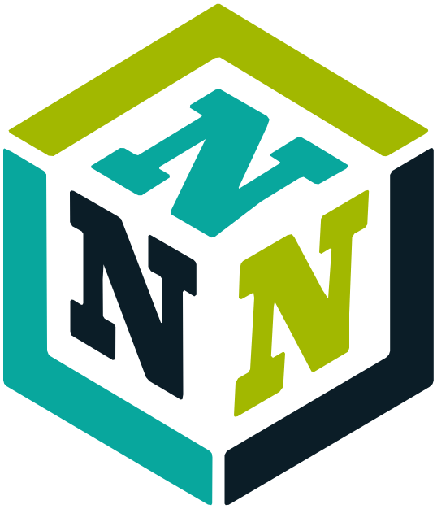

<picture>
  <source media="(prefers-color-scheme: dark)" srcset="assets/logo-dark.svg">
  
</picture>

# Nicolas Ponciano

**Desenvolvedor de software full stack**

Desenvolvo sistemas web corporativos com **.NET e SQL Server**. Também crio ferramentas para o meu dia a dia e curso pós-graduação em Inteligência Artificial.

[Meu portfólio](https://nicolasponciano.github.io/) · [LinkedIn](https://www.linkedin.com/in/nicolas-ponciano/)

 

## Projetos

### MarcAi

Next.js · TypeScript · PostgreSQL

Criei uma agenda para salões, clínicas e estúdios. Quem vai marcar um horário escolhe o serviço e vê a disponibilidade do profissional.

[Experimentar o agendamento](https://marcai-demo.netlify.app/)

Como trato duas tentativas de reservar o mesmo horário?

Calculo os horários disponíveis a partir da agenda do profissional e da duração do serviço. Antes de confirmar a reserva, verifico o conflito no servidor. Uso uma chave de idempotência para reconhecer quando o mesmo pedido chega de novo.

### Seirei

Next.js · TypeScript · Supabase

Fiz um aplicativo que mostra uma tarefa por vez e mantém a lista sincronizada entre o celular e o computador.

[Conhecer o modo foco no portfólio](https://nicolasponciano.github.io/#projeto/seirei)

O que acontece quando a IA não consegue ordenar as tarefas?

Guardo no Supabase a ordem em que as tarefas entraram. Quando a IA sugere uma sequência, confiro se ela corresponde às tarefas do dia. Se a chamada falhar, o modo foco segue a ordem de inserção.

### Open Mind

TypeScript · Node.js · OpenCode

Escrevi um plugin em TypeScript para consultar minhas notas do Obsidian dentro do OpenCode.

[Explorar o plugin para OpenCode](https://github.com/nicolasponciano/open-mind)

Como controlo a escrita nas notas do Obsidian?

Limitei a leitura à pasta do vault e deixei a escrita desabilitada por padrão. Quando autorizo uma alteração, o plugin compara o hash da nota com o da versão que leu. Assim ele detecta se houve uma edição nesse intervalo.

### ClienteAPI

C# · .NET 8 · SQL Server

Integrei o ViaCEP a uma API em C# e .NET 8 para cadastrar clientes e buscar endereços por CEP. Uso SQL Server para guardar os dados.

[Ver a implementação em C#](https://github.com/nicolasponciano/ClienteAPI)

Como uso o CEP no cadastro de clientes?

Consulto o ViaCEP para validar o CEP informado e obter os dados do endereço. Salvo o resultado para consultas futuras e uso o CEP também como filtro para encontrar clientes cadastrados.

