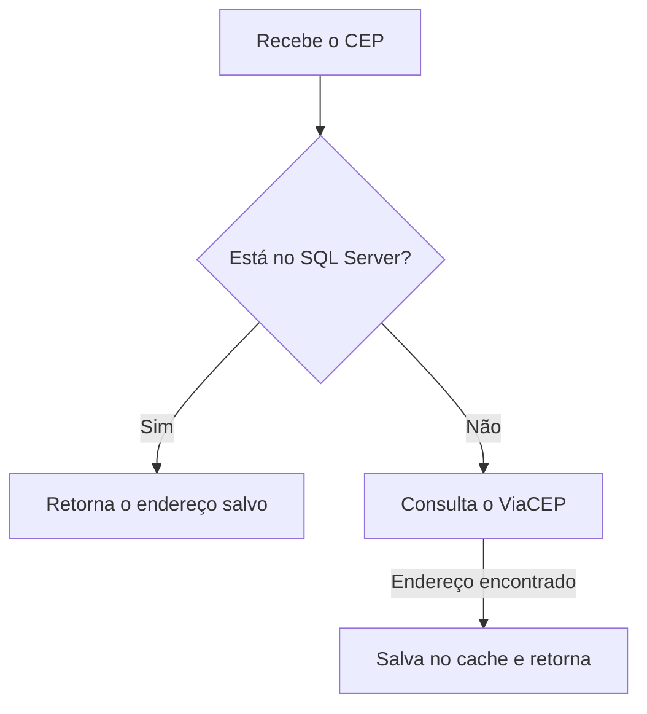

<h1>
  <picture>
    <source media="(prefers-color-scheme: dark)" srcset="./assets/editorial-dark.svg">
    
  </picture>
</h1>

**Procurando Vagas** · Desenvolvedor .NET

Desenvolvo e mantenho sistemas web corporativos com **C#, .NET e SQL Server**. Trabalho com APIs e integrações e curso pós-graduação em Inteligência Artificial.

[Projetos em destaque](#projetos-em-destaque)　·　[Stack técnica](#stack-técnica)　·　[Contato](#contato)

## Projetos em destaque

### [ClienteAPI](https://github.com/nicolasponciano/ClienteAPI) · Cadastro de clientes

API em C# e .NET 8 que consulta o endereço pelo CEP durante o cadastro de clientes.

**Como funciona** · A API procura o CEP no SQL Server antes de chamar o ViaCEP. Quando encontra o endereço no cache, resolve a consulta sem depender do serviço externo.

<details>
<summary>Ver o caminho de uma consulta por CEP</summary>



</details>

### [MarcAI](https://marcai-demo.netlify.app/) · Agendamento online

Aplicação em Next.js, TypeScript e PostgreSQL para marcar horários e gerenciar uma agenda.

**Como funciona** · As permissões seguem o papel de cada usuário. Quem agenda um horário e quem administra a agenda têm acesso a operações diferentes.

[](https://marcai-demo.netlify.app/)

[Experimentar a demo ↗](https://marcai-demo.netlify.app/)

### [Seirei](https://seirei.netlify.app/) · Foco e organização de tarefas

Aplicação em Next.js, TypeScript e Supabase que usa IA para sugerir em que ordem fazer as tarefas.

**Como funciona** · O servidor envia as tarefas ao modelo e recebe a ordem sugerida em uma resposta estruturada. A interface usa essa sequência para apresentar a lista.

<details>
<summary>Ver a tela de foco do Seirei</summary>


</details>

### [Open Mind](https://github.com/nicolasponciano/open-mind) · Consulta ao Obsidian pelo OpenCode

Plugin em TypeScript que permite consultar notas do Obsidian durante uma sessão de desenvolvimento.

**Como funciona** · As notas continuam no Obsidian. O plugin oferece ferramentas de consulta ao OpenCode para recuperar o contexto de um projeto enquanto trabalho nele.

<details>
<summary>Ver uma busca por decisões de agendamento</summary>

```json
{
  "query": "agendamento",
  "scope": "projetos"
}
```

A ferramenta `open_mind_search` devolve o trecho encontrado e o caminho da nota.

</details>

Também desenvolvo o [bug-hunter](https://github.com/nicolasponciano/bug-hunter), um agente de revisão de código para Codex e OpenCode.

## Stack técnica

| Área | Tecnologias |
| --- | --- |
| Backend |   |
| Frontend |   |
| Banco de dados |   |
| Ferramentas e serviços |   |

## Contato

[LinkedIn](https://www.linkedin.com/in/nicolas-leonardo-ponciano/) · [Portfólio](https://nicolasponciano.github.io/) · [niickponciano@gmail.com](mailto:niickponciano@gmail.com)

<details>
  <summary>Estatísticas do GitHub</summary>

  

</details>
