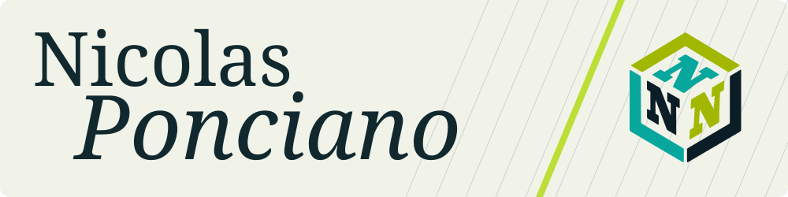
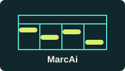
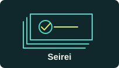
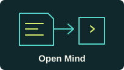
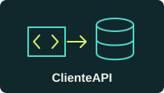

<picture>
  <source media="(prefers-color-scheme: dark)" srcset="assets/atlas/dark.svg">
  
</picture>

**Desenvolvedor de software full stack.** Trabalho com .NET e SQL Server em sistemas web corporativos. Também crio ferramentas para usar no dia a dia e curso pós-graduação em Inteligência Artificial.

[Portfólio](https://nicolasponciano.github.io/) · [LinkedIn](https://www.linkedin.com/in/nicolas-ponciano/)

## Projetos

   

### MarcAi

Criei uma agenda para salões, clínicas e estúdios. A página pública de cada estabelecimento mostra os horários disponíveis por profissional e serviço.

[Experimentar o agendamento](https://marcai-demo.netlify.app/) · Next.js · TypeScript · PostgreSQL

Como evito duas reservas no mesmo horário?

Calculo a disponibilidade a partir da agenda e da duração do serviço. Antes de confirmar, verifico o conflito no servidor. Se o mesmo pedido chegar duas vezes, reconheço a repetição pela chave de idempotência.

---

### Seirei

Fiz um aplicativo para trabalhar em uma tarefa por vez e continuar de onde parei ao trocar o computador pelo celular.

[Ver o modo foco](https://nicolasponciano.github.io/#projeto/seirei) · Next.js · TypeScript · Supabase

E se a IA não conseguir ordenar as tarefas?

Guardo a ordem de inserção no Supabase. Confiro a sequência sugerida pela IA contra as tarefas do dia e, se a chamada falhar, uso a ordem original.

---

### Open Mind

Escrevi um plugin para consultar minhas notas do Obsidian durante uma sessão do OpenCode.

[Explorar o plugin](https://github.com/nicolasponciano/open-mind) · TypeScript · Node.js · OpenCode

Quando o agente pode alterar uma nota?

Restrinjo a leitura à pasta do vault e deixo a escrita desabilitada por padrão. Quando autorizo uma alteração, o plugin compara o hash atual com o da versão lida para detectar edições feitas nesse intervalo.

---

### ClienteAPI

Integrei o ViaCEP a uma API de cadastro de clientes. Posso consultar um endereço pelo CEP e localizar clientes cadastrados na mesma região postal.

[Ler a implementação em C#](https://github.com/nicolasponciano/ClienteAPI) · C# · .NET 8 · SQL Server

O que acontece depois da consulta ao ViaCEP?

Salvo os dados do endereço no SQL Server para consultas futuras. A API também permite usar o CEP como filtro ao listar os clientes.

