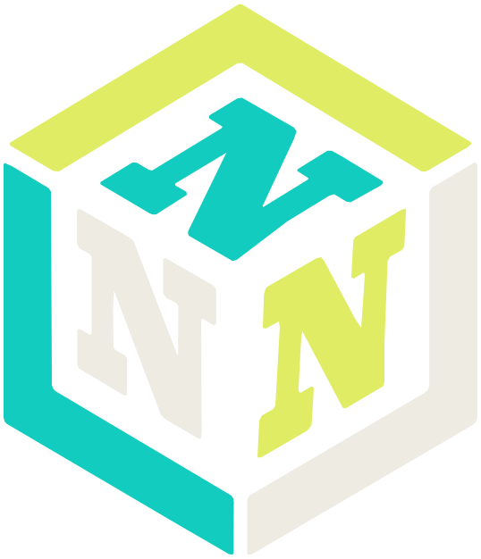
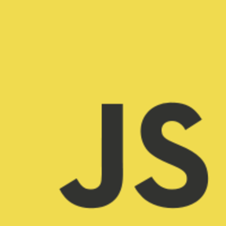
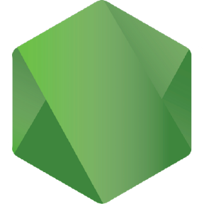
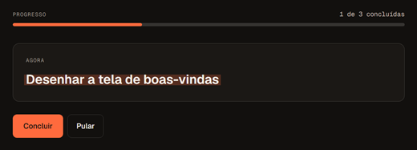

# Nicolas Ponciano

Desenvolvo sistemas web com .NET e SQL Server.

## Meu GitHub

Selecione um card para explorar os dados de 23/11/2025 a 23/11/2026.

<picture></picture>

[Explorar meus repositórios](https://github.com/nicolasponciano?tab=repositories) · [Portfólio](https://github.com/nicolasponciano/nicolasponciano.github.io) · [Open Mind](https://github.com/nicolasponciano/open-mind)

<picture></picture>

Distribuição por bytes nos meus repositórios públicos, excluindo forks.

| Linguagem | Por volume de código | Projeto para explorar |
| --- | ---: | --- |
| JavaScript | 39,9% | [ProjectFit](https://github.com/nicolasponciano/ProjectFit) |
| C# | 23,7% | [ProjectFit](https://github.com/nicolasponciano/ProjectFit) |
| ASP.NET | 12,8% | [ProjectFit](https://github.com/nicolasponciano/ProjectFit) |
| TypeScript | 9,8% | [open-mind](https://github.com/nicolasponciano/open-mind) |
| Python | 4,6% | [open-mind](https://github.com/nicolasponciano/open-mind) |
| CSS | 3,7% | [nicolasponciano.github.io](https://github.com/nicolasponciano/nicolasponciano.github.io) |

<picture></picture>

De 12/11/2026 a 19/11/2026.

[12/11 (4)](https://github.com/nicolasponciano?tab=overview&from=2026-11-12&to=2026-11-12) · [13/11 (1)](https://github.com/nicolasponciano?tab=overview&from=2026-11-13&to=2026-11-13) · [14/11 (14)](https://github.com/nicolasponciano?tab=overview&from=2026-11-14&to=2026-11-14) · [15/11 (2)](https://github.com/nicolasponciano?tab=overview&from=2026-11-15&to=2026-11-15) · [16/11 (2)](https://github.com/nicolasponciano?tab=overview&from=2026-11-16&to=2026-11-16) · [17/11 (5)](https://github.com/nicolasponciano?tab=overview&from=2026-11-17&to=2026-11-17) · [18/11 (5)](https://github.com/nicolasponciano?tab=overview&from=2026-11-18&to=2026-11-18) · [19/11 (2)](https://github.com/nicolasponciano?tab=overview&from=2026-11-19&to=2026-11-19)

<picture></picture>

Escolha um mês para explorar a atividade no GitHub.

[11/2025 (0)](https://github.com/nicolasponciano?tab=overview&from=2025-11-01&to=2025-11-30) · [12/2025 (1)](https://github.com/nicolasponciano?tab=overview&from=2025-12-01&to=2025-12-31) · [01/2026 (0)](https://github.com/nicolasponciano?tab=overview&from=2026-01-01&to=2026-01-31) · [02/2026 (0)](https://github.com/nicolasponciano?tab=overview&from=2026-02-01&to=2026-02-28) · [03/2026 (0)](https://github.com/nicolasponciano?tab=overview&from=2026-03-01&to=2026-03-31) · [04/2026 (0)](https://github.com/nicolasponciano?tab=overview&from=2026-04-01&to=2026-04-30) · [05/2026 (0)](https://github.com/nicolasponciano?tab=overview&from=2026-05-01&to=2026-05-31) · [06/2026 (12)](https://github.com/nicolasponciano?tab=overview&from=2026-06-01&to=2026-06-30) · [07/2026 (0)](https://github.com/nicolasponciano?tab=overview&from=2026-07-01&to=2026-07-31) · [08/2026 (0)](https://github.com/nicolasponciano?tab=overview&from=2026-08-01&to=2026-08-31) · [09/2026 (0)](https://github.com/nicolasponciano?tab=overview&from=2026-09-01&to=2026-09-30) · [10/2026 (0)](https://github.com/nicolasponciano?tab=overview&from=2026-10-01&to=2026-10-31) · [11/2026 (49)](https://github.com/nicolasponciano?tab=overview&from=2026-11-01&to=2026-11-23)

[Meu portfólio](https://nicolasponciano.github.io/) · [LinkedIn](https://www.linkedin.com/in/nicolas-ponciano/)

---

## Tecnologias que uso

<code></code> <code></code> <code></code> <code></code> <code></code> <code></code> <code></code>

---

## Meus projetos

- **MarcAi** — Criei uma agenda para salões, clínicas e estúdios. A página pública de cada estabelecimento mostra os horários disponíveis por profissional e serviço. [Experimentar o agendamento](https://marcai-demo.netlify.app/)

  

  
Como evito duas reservas no mesmo horário?

  `Next.js` `TypeScript` `PostgreSQL`

  Calculo a disponibilidade a partir da agenda e da duração do serviço. Antes de confirmar, verifico o conflito no servidor. Se o mesmo pedido chegar duas vezes, reconheço a repetição pela chave de idempotência.

  

  

- **Seirei** — Fiz um aplicativo para trabalhar em uma tarefa por vez e continuar de onde parei ao trocar o computador pelo celular. [Ver o modo foco](https://nicolasponciano.github.io/#projeto/seirei)

  

  
E se a IA não conseguir ordenar as tarefas?

  `Next.js` `TypeScript` `Supabase`

  Guardo a ordem de inserção no Supabase. Confiro a sequência sugerida pela IA contra as tarefas do dia e, se a chamada falhar, uso a ordem original.

  

  

- **Open Mind** — Escrevi um plugin para consultar minhas notas do Obsidian durante uma sessão do OpenCode. [Explorar o plugin](https://github.com/nicolasponciano/open-mind)

  

  
Quando o agente pode alterar uma nota?

  `TypeScript` `Node.js` `OpenCode`

  Restrinjo a leitura à pasta do vault e deixo a escrita desabilitada por padrão. Quando autorizo uma alteração, o plugin compara o hash atual com o da versão lida para detectar edições feitas nesse intervalo.

  

- **ClienteAPI** — Integrei o ViaCEP a uma API de cadastro de clientes. Posso consultar um endereço pelo CEP e localizar clientes cadastrados na mesma região postal. [Ler a implementação em C#](https://github.com/nicolasponciano/ClienteAPI)

  

  
O que acontece depois da consulta ao ViaCEP?

  `C#` `.NET 8` `SQL Server`

  Salvo os dados do endereço no SQL Server para consultas futuras. A API também permite usar o CEP como filtro ao listar os clientes.

  

