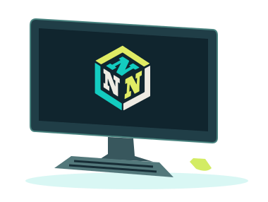

## Olá, sou o Nicolas Ponciano

Desenvolvo sistemas web corporativos com **.NET e SQL Server**. Atualmente curso pós-graduação em Inteligência Artificial.

💻 **Linguagens que uso:** C#, TypeScript e JavaScript. 
🛠️ **No dia a dia:** APIs, bancos relacionais e integrações. 
✉️ **Onde me encontrar:** [LinkedIn](https://www.linkedin.com/in/nicolas-ponciano/) · [Portfólio](https://nicolasponciano.github.io/)

 

## Meus projetos

**MarcAi** 
Criei uma agenda para salões, clínicas e estúdios. A página pública de cada estabelecimento mostra os horários disponíveis por profissional e serviço. 
`Next.js` `TypeScript` `PostgreSQL` 
[Experimentar o agendamento](https://marcai-demo.netlify.app/)

 

Como evito duas reservas no mesmo horário?

Calculo a disponibilidade a partir da agenda e da duração do serviço. Antes de confirmar, verifico o conflito no servidor. Se o mesmo pedido chegar duas vezes, reconheço a repetição pela chave de idempotência.

**Seirei** 
Fiz um aplicativo para trabalhar em uma tarefa por vez e continuar de onde parei ao trocar o computador pelo celular. 
`Next.js` `TypeScript` `Supabase` 
[Ver o modo foco](https://nicolasponciano.github.io/#projeto/seirei)

 

E se a IA não conseguir ordenar as tarefas?

Guardo a ordem de inserção no Supabase. Confiro a sequência sugerida pela IA contra as tarefas do dia e, se a chamada falhar, uso a ordem original.

**Open Mind** 
Escrevi um plugin para consultar minhas notas do Obsidian durante uma sessão do OpenCode. 
`TypeScript` `Node.js` `OpenCode` 
[Explorar o plugin](https://github.com/nicolasponciano/open-mind)

 

Quando o agente pode alterar uma nota?

Restrinjo a leitura à pasta do vault e deixo a escrita desabilitada por padrão. Quando autorizo uma alteração, o plugin compara o hash atual com o da versão lida para detectar edições feitas nesse intervalo.

**ClienteAPI** 
Integrei o ViaCEP a uma API de cadastro de clientes. Posso consultar um endereço pelo CEP e localizar clientes cadastrados na mesma região postal. 
`C#` `.NET 8` `SQL Server` 
[Ler a implementação em C#](https://github.com/nicolasponciano/ClienteAPI)

 

O que acontece depois da consulta ao ViaCEP?

Salvo os dados do endereço no SQL Server para consultas futuras. A API também permite usar o CEP como filtro ao listar os clientes.

