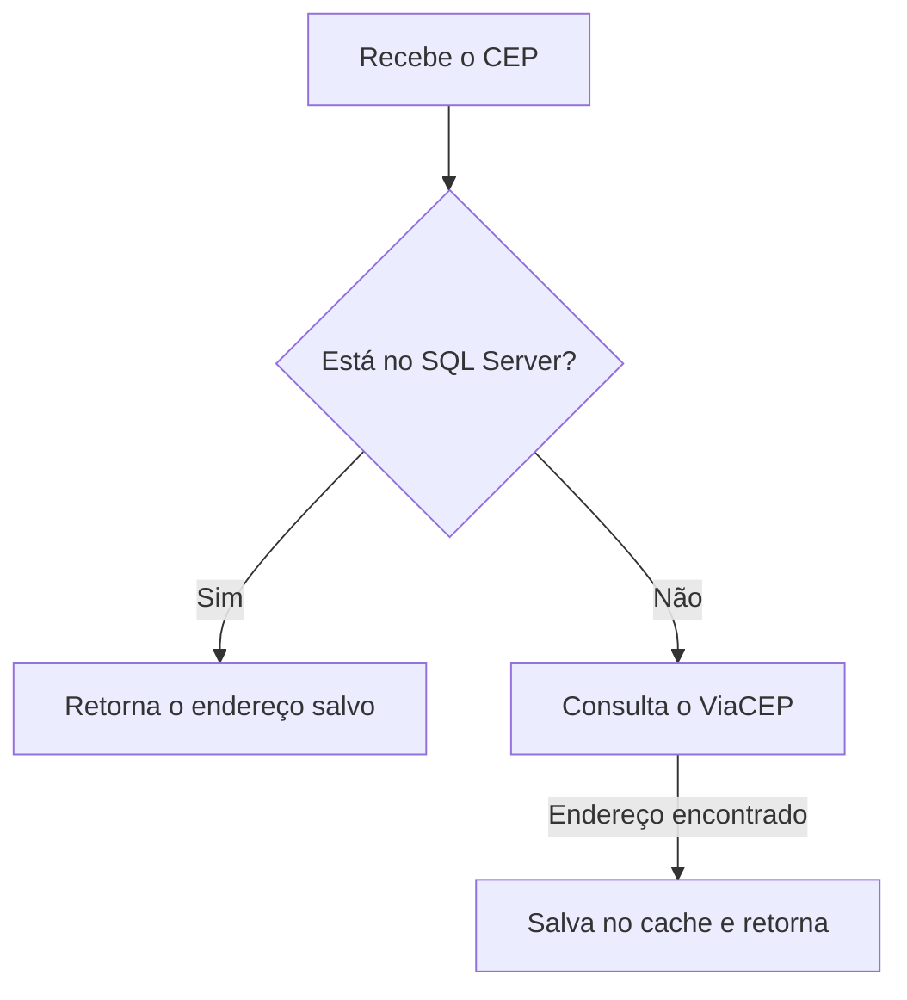

<h1>
  <picture>
    <source media="(prefers-color-scheme: dark)" srcset="./assets/editorial-dark.svg">
    
  </picture>
</h1>

**Desenvolvedor Fullstack**  

Desenvolvo e mantenho sistemas web corporativos com **C#, .NET e SQL Server**. Trabalho com APIs e integrações e curso pós-graduação em Inteligência Artificial.

[Projetos em destaque](#projetos-em-destaque)　·　[Experiência profissional](#experiência-profissional)　·　[Stack técnica](#stack-técnica)　·　[Contato](#contato)

## Projetos em destaque

| O que você quer explorar? | Comece aqui |
| --- | --- |
| Integrações em .NET | [Acompanhar um CEP pelo cache](#consulta-cep) |
| Uma aplicação em uso | [Experimentar a agenda do MarcAI](https://marcai-demo.netlify.app/) |
| IA em um fluxo de trabalho | [Ver como o Seirei organiza o dia](#foco-seirei) |
| Ferramentas para desenvolvedores | [Explorar uma consulta ao Obsidian](#busca-obsidian) |

<a name="consulta-cep"></a>

### [ClienteAPI](https://github.com/nicolasponciano/ClienteAPI) · Cadastro de clientes

API em C# e .NET 8 que consulta o endereço pelo CEP durante o cadastro de clientes.

Imagine dois cadastros com o mesmo CEP válido. Abra cada consulta para acompanhar o que acontece.

<details>
<summary>Primeiro cadastro · O CEP ainda não existe no cache</summary>

A API procura o CEP no SQL Server, consulta o ViaCEP e grava o endereço retornado. Esse registro fica disponível para os próximos cadastros.

</details>

<details>
<summary>Segundo cadastro · O CEP já está salvo</summary>

A API encontra o endereço no SQL Server e o devolve diretamente. Os dois cadastros recebem o endereço, mas só o primeiro precisa consultar o ViaCEP.

</details>

<details>
<summary>Ver o caminho de uma consulta por CEP</summary>



</details>

### [MarcAI](https://marcai-demo.netlify.app/) · Agendamento online

Aplicação em Next.js, TypeScript e PostgreSQL para marcar horários e gerenciar uma agenda.

**Como funciona** · As permissões seguem o papel de cada usuário. Quem agenda um horário e quem administra a agenda têm acesso a operações diferentes.

[](https://marcai-demo.netlify.app/)

[Experimentar a demo ↗](https://marcai-demo.netlify.app/)

<a name="foco-seirei"></a>

### [Seirei](https://seirei.netlify.app/) · Foco e organização de tarefas

Aplicação em Next.js, TypeScript e Supabase que usa IA para sugerir em que ordem fazer as tarefas.

**Como funciona** · O servidor envia as tarefas ao modelo e recebe a ordem sugerida em uma resposta estruturada. A interface usa essa sequência para apresentar a lista.

<details>
<summary>Ver a tela de foco do Seirei</summary>


</details>

[Abrir o Seirei ↗](https://seirei.netlify.app/)

<a name="busca-obsidian"></a>

### [Open Mind](https://github.com/nicolasponciano/open-mind) · Consulta ao Obsidian pelo OpenCode

Plugin em TypeScript que permite consultar notas do Obsidian durante uma sessão de desenvolvimento.

**Como funciona** · As notas continuam no Obsidian. O plugin oferece ferramentas de consulta ao OpenCode para recuperar o contexto de um projeto enquanto trabalho nele.

<details>
<summary>Ver uma busca por decisões de agendamento</summary>

```json
{
  "query": "agendamento",
  "scope": "projetos"
}
```

A ferramenta `open_mind_search` devolve o trecho encontrado e o caminho da nota.

</details>

[Explorar a implementação de open_mind_search](https://github.com/nicolasponciano/open-mind/blob/564eddbb8783ad0ce69ae436d0c6106683f94beb/src/tools/open-mind-tools.ts#L285)

Também desenvolvo o [bug-hunter](https://github.com/nicolasponciano/bug-hunter), um agente de revisão de código para Codex e OpenCode.

## Experiência profissional

Atuo no desenvolvimento e na manutenção de sistemas web corporativos, do levantamento de requisitos ao suporte em produção. Meu trabalho inclui implementar integrações com APIs, testar alterações e acompanhar a publicação de novas versões.

| Período | Cargo | Empresa |
| --- | --- | --- |
| Fev. 2026 – atual | Desenvolvedor de Software Júnior | Empresa do setor de tecnologia · Rio de Janeiro |
| Jul. 2025 – fev. 2026 | Desenvolvedor de Software Júnior | SOFTCASE Soluções Tecnológicas · Santos |
| Jul. 2024 – jul. 2025 | Estágio em Desenvolvimento de Software | SOFTCASE Soluções Tecnológicas · São Vicente |

## Stack técnica

| Área | Tecnologias |
| --- | --- |
| Backend |   |
| Frontend |   |
| Banco de dados |   |
| Ferramentas e serviços |   |

## Contato

[LinkedIn](https://www.linkedin.com/in/nicolas-leonardo-ponciano/) · [Portfólio](https://nicolasponciano.github.io/) · [niickponciano@gmail.com](mailto:niickponciano@gmail.com)

<details>
  <summary>Estatísticas do GitHub</summary>

  

</details>

[↑ Voltar aos projetos](#projetos-em-destaque)
